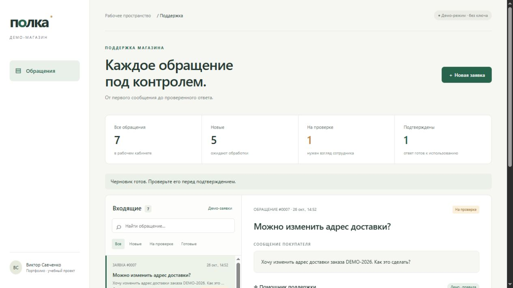

# Полка · кабинет поддержки интернет-магазина

Учебный проект для портфолио: приём обращения по REST API → определение категории → подготовка черновика → проверка и подтверждение сотрудником.

Учебный проект Виктора Савченко, разработанный с помощью Codex. Сценарий и формат кабинета выбраны автором; код, оформление, документация и автоматизированные проверки подготовлены с помощью ИИ. Демонстрация использует вымышленные данные и не содержит материалов работодателей. Коммерческое внедрение, экономия времени и точность классификации на реальных клиентах не заявляются.

**[Портфолио автора](docs/PORTFOLIO.md)** · **[Скачать портфолио в PDF](docs/portfolio.pdf)**




## Возможности

- Рабочий кабинет со списком обращений, поиском, фильтрами и счётчиками статусов.
- Создание заявки через форму или JSON API.
- Категории: доставка, возврат, вопрос о товаре, другое.
- Редактируемый черновик ответа и изменение категории сотрудником.
- Подтверждение ответа; повторная обработка подтверждённой заявки блокируется.
- Хранение данных в SQLite и история действий.
- Шесть вымышленных примеров; повторная загрузка не создаёт дубли.
- Адаптивный интерфейс без внешних библиотек, шрифтов и CDN.

**Режим по умолчанию — DEMO:** классификация по ключевым словам и шаблонные ответы. Он не использует языковую модель и не выдаёт правила за ИИ. Для реальной генерации предусмотрен LLM-адаптер. Ответы не отправляются клиентам: «Подтвердить» только фиксирует результат проверки внутри приложения.

## Запуск

Нужен Python 3.10 или новее. Установка сторонних пакетов не требуется.

```bash
python server.py
```

Откройте http://127.0.0.1:8765 и нажмите «Демо-заявки». Остановка — Ctrl+C. База `support.sqlite3` создаётся при первом запуске и сохраняется между запусками.

Windows: если команда `python` недоступна, используйте `py server.py` или полный путь к установленному Python.

## Как показать проект за две минуты

1. Загрузите примеры и откройте обращение о доставке.
2. Нажмите «Обработать заявку»: появятся категория, пояснение и черновик.
3. Измените формулировку и сохраните правки.
4. Подтвердите ответ; проверьте статус, счётчик и историю обработки.
5. Создайте новую заявку о возврате и повторите сценарий.

Объясните при показе, что DEMO работает по правилам, а LLM подключается отдельно. Не утверждайте, что модель уже испытана на реальных покупателях.

## Подключение языковой модели

Адаптер поддерживает провайдеров с контрактом Chat Completions: POST JSON с `model` и `messages`, Bearer-авторизация, ответ `choices[0].message.content`. Укажите полный HTTPS URL из документации выбранного провайдера. Модель должна возвращать JSON в тексте ответа; дополнительные параметры разных провайдеров могут потребовать доработки адаптера.

Пример для PowerShell:

```powershell
$env:SUPPORT_MODE = 'llm'
$env:LLM_CHAT_URL = 'https://YOUR-PROVIDER/YOUR-CHAT-ENDPOINT'
$env:LLM_MODEL = 'YOUR-MODEL'
# Задайте LLM_API_KEY локально через средство управления секретами или окружение.
python server.py
```

`LLM_API_KEY` читается только сервером из окружения. Не включайте ключ в код, браузер или Git. `.env` автоматически не загружается. В режиме LLM тема и сообщение передаются настроенному провайдеру; используйте вымышленные данные. Провайдер может взимать плату. При ошибке сети или некорректном JSON заявка остаётся сохранённой, выводится ошибка; скрытой подмены результата шаблоном нет.

Живой платный LLM-вызов при подготовке проекта не выполнялся. Контракт адаптера проверен с имитацией провайдера; реальная совместимость зависит от выбранной модели и endpoint.

## API

Все POST-запросы используют `Content-Type: application/json`.

| Метод | Путь | Назначение |
|---|---|---|
| GET | `/api/config` | Текущий режим обработки |
| GET | `/api/tickets` | Список обращений |
| POST | `/api/tickets` | Создание: `subject`, `message` |
| POST | `/api/seed` | Примеры для пустой базы, тело `{}` |
| POST | `/api/tickets/{id}/analyze` | Категория и черновик, тело `{}` |
| POST | `/api/tickets/{id}/draft` | Сохранение: `draft`, `category` |
| POST | `/api/tickets/{id}/approve` | Подтверждение: `draft`, `category` |
| GET | `/api/tickets/{id}/events` | История действий |

Пример PowerShell:

```powershell
$body = @{ subject = 'Где заказ?'; message = 'Когда приедет заказ DEMO-2001?' } | ConvertTo-Json
Invoke-RestMethod -Uri http://127.0.0.1:8765/api/tickets -Method Post -ContentType 'application/json; charset=utf-8' -Body ([Text.Encoding]::UTF8.GetBytes($body))
```

Статусы: `new → review → approved`. Подтверждённые заявки неизменяемы через API. Ошибки входных данных — 400, неизвестный ресурс — 404, ошибка провайдера — 502. Поля ограничены по длине; недопустимые категории и операции отклоняются.

## Архитектура

```text
Браузер (HTML + CSS + JavaScript)
                 │ JSON / HTTP
                 ▼
Python HTTP-сервер ───── SQLite (заявки + события)
                 │
                 ├── DEMO: правила + шаблоны
                 └── LLM: HTTPS → настроенный провайдер
```

`server.py` — API, хранение и адаптер модели; `static/` — интерфейс; `test_server.py` — проверки жизненного цикла и ошибок; `docs/CASE.md` — описание задачи и проектных решений.

## Проверки

```bash
python -m unittest -v
```

Проверяются: полный цикл заявки и сохранение в базе, запрет изменений после подтверждения, история действий, валидация, запрет запросов с другого сайта, отсутствие дублей демо-заявок, категории, приоритет возврата, сбой LLM без потери заявки, формат запроса и ответа LLM-адаптера.

## Ограничения

Локальная демонстрация, сервер слушает только `127.0.0.1`. Нет авторизации, ролей, подключения магазина, реального каталога/заказов, почтовой или CRM-отправки. Не выставляйте этот сервер в интернет. Для эксплуатации нужны серверный фреймворк, авторизация, HTTPS, контроль доступа, лимиты запросов, наблюдаемость, резервное копирование и оценка ответов на размеченном наборе. Системная инструкция снижает вероятность нежелательных ответов, но не гарантирует защиту от prompt injection; финальная проверка сотрудником обязательна.

Это помощник подготовки ответа. Он не проверяет фактический статус заказа и не принимает решения о возврате денег.
