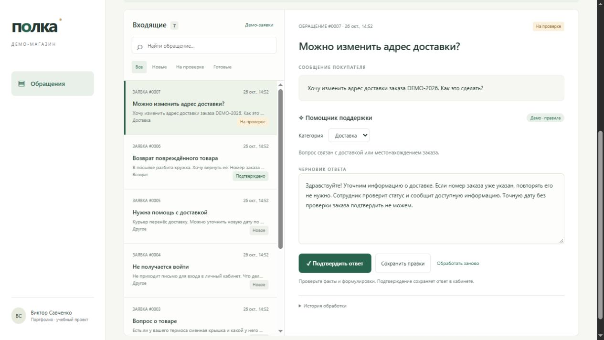

# Виктор Савченко

**Автоматизация процессов · Python · API · ИИ-инструменты**

Рассматриваю удалённую проектную подработку по субботам и воскресеньям, со свободным графиком в пределах этих дней. Объём, сроки, созвоны и оплату согласовываю до начала работы.

## Проект «Полка»: кабинет поддержки интернет-магазина

**Формат:** учебный демонстрационный проект на вымышленных данных, разработан с помощью Codex.

**Задача:** организовать обработку обращений покупателей в одном кабинете: принять сообщение, определить тему, подготовить черновик ответа и передать его сотруднику на проверку.

**Сценарий:** обращение через форму или REST API → категория → черновик ответа → правки сотрудника → подтверждение → сохранение истории.

### Что можно проверить

- Создание обращения через интерфейс или JSON API.
- Категории: доставка, возврат, вопросы о товаре, другое.
- Поиск заявок и фильтрация по статусу.
- Редактирование категории и текста ответа.
- Подтверждение ответа и история действий.
- Сохранение данных после перезапуска приложения.

### Технологии и интеграция

Python, REST API, JSON, SQLite, HTML, CSS, JavaScript. Для языковой модели предусмотрен адаптер к HTTPS API с Bearer-авторизацией, валидацией JSON и обработкой ошибок.

В режиме DEMO используются правила и шаблоны; ключ не нужен. Реальная LLM-генерация требует подключения провайдера. Живой вызов модели пока не проверен. Подтверждение ответа сохраняет его в кабинете; отправки покупателям нет.

### Участие

Я выбрал сценарий интернет-магазина и формат рабочего кабинета. Код, оформление, документация и автоматизированные проверки подготовлены с помощью Codex. Коммерческое внедрение и измеренная экономия времени для этого проекта не заявляются.

### Проверка результата

Семь автоматизированных тестов: жизненный цикл заявки и хранение, валидация ввода, ограничения изменений после подтверждения, история, повторная загрузка примеров без дублей, классификация и ошибки LLM-адаптера. Сценарии создания, обработки, редактирования, подтверждения и поиска дополнительно проверены в браузере.

### Ссылки

- [Код, инструкция запуска и скриншоты](https://github.com/viktorsav4/shop-support-desk)
- [Версия портфолио в PDF](portfolio.pdf)
- [Профиль GitHub](https://github.com/viktorsav4)

Запуск: Python 3.10+ → `python server.py` → `http://127.0.0.1:8765` → «Демо-заявки». Сторонние пакеты не требуются.
